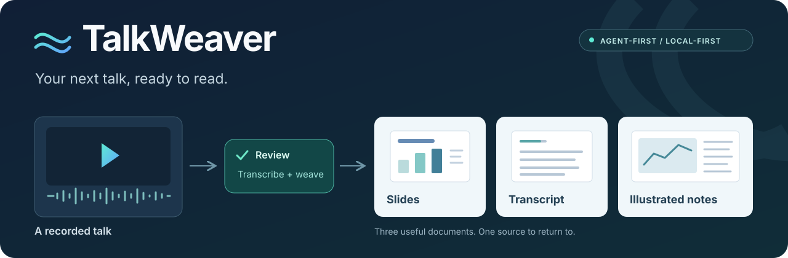

<div align="center">



### Less replay. More insight.

**Give your agent a video. Get the slides, the words, and a reader that brings them together.**

[](pyproject.toml)
[](SKILL.md)
[](docs/usage.md#known-limitations)
[](LICENSE)

[Start with an agent](#start-with-an-agent) · [Setup guide](docs/usage.md) · [简体中文](docs/README.zh-CN.md) · [Feedback](https://github.com/Xplore-LAB/talkweaver/issues)

</div>

---

TalkWeaver turns recorded lectures, webinars, and presentations into documents you can revisit. It is a **CLI + Agent Skill**: the tools handle processing, while your agent checks slide boundaries, duplicate pages, and technical wording. No management UI is needed.

> Early alpha for Linux. Agent review is required; browser livestream capture is not implemented yet.

## One video, three useful outputs

| Keep | Get | Use it to |
| --- | --- | --- |
| **The slides** | A cropped, deduplicated screenshot PDF | Browse the deck without scrubbing through the video. |
| **The words** | A timestamped, corrected transcript | Search, quote with source context, and make your own edits. |
| **The story** | A slide-and-speech PDF | Read each slide beside its corresponding explanation. |

Optional outputs include audio, subtitles, and an editable HTML reader with a shared playback bar and segment-level audio anchors.

## Start with an agent

**1. Get the toolkit.** Clone this repository and follow the [setup guide](docs/usage.md#requirements) to prepare Python, media tools, fonts, and local model weights.

**2. Give your agent the video and the Skill.** In a coding agent with local command access, say:

> Read `SKILL.md`. Use TalkWeaver to turn `/path/to/talk.mp4` into a slide PDF, a transcript, and illustrated notes. Check the environment first, review the slides and wording, and keep job files outside this repository.

**3. Open the results.** The agent delivers the files listed in the job's `delivery.json`, along with any source gaps or unresolved recognition issues.

Prefer the terminal? Start with `talkweaver doctor`; the [command walkthrough](docs/usage.md#quick-start) and [Skill](SKILL.md) cover the rest.

## Built for an agent that checks its work

- **Follow the slides, not a timer.** Extract stable visual changes inside a reviewed slide region, then use OCR and image comparison to organize candidates.
- **Keep the explanation beside the picture.** Preserve source intervals when a slide is revisited; assign speech once instead of copying it across pages.
- **Review without losing the original.** Keep ASR receipts, source text, timestamps, and correction records. Punctuation restoration is a separate step from proofreading.
- **Pick up where you left off.** Reuse compatible caches; refuse conflicting inputs, concurrent edits, and accidental output overwrites.

The workflow is **import → transcribe → review slides and speech → export**. `run` returns the next review task so the agent can continue without asking you to approve every routine step.

## Local by default

Processing uses local models and tools, with no cloud inference or messaging integration. Private videos, job outputs, credentials, and model weights stay outside the source repository.

A hosted agent may still send the text or images it reads to its provider. For confidential media, use a suitably local agent or explicitly authorize that data flow. [Privacy details and limitations](docs/usage.md#privacy-and-data-boundaries)

## A small, focused repository

```text
talkweaver/
├── src/talkweaver/   # CLI and processing pipeline
├── tests/           # Synthetic regression tests
├── docs/            # Setup, Chinese overview, and assets
├── SKILL.md         # Agent workflow and review rules
├── pyproject.toml   # Package and dependency configuration
└── LICENSE
```

[Install & run](docs/usage.md) · [Agent Skill](SKILL.md) · [Run the tests](docs/usage.md#tests) · [Known limitations](docs/usage.md#known-limitations)

AGPL-3.0-or-later. Model weights and third-party dependencies retain their own licenses. [License](LICENSE)
