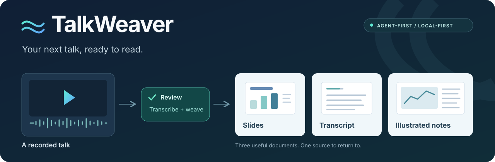

### 少拖几次进度条，多留下真正有用的内容。

**给 Agent 一段视频，拿回 PPT、讲述文本，以及左图右字的图文纪要。**

[English](../README.md) · [安装与使用](usage.md) · [Agent Skill](../SKILL.md) · [反馈](https://github.com/Xplore-LAB/talkweaver/issues)

---

TalkWeaver 面向讲座、会议报告和课程录像，以 **命令行工具 + Agent Skill** 的形式工作。脚本负责转写、截图和导出，Agent 负责检查报告边界、重复页面和专业用词，无需额外管理界面。

> 当前是 Linux 早期版本，需要 Agent 核对；通用浏览器直播录制尚未实现。

## 一段视频，三份资料

| 资料 | 内容 | 用途 |
| --- | --- | --- |
| **PPT PDF** | 按翻页提取、裁切和去重后的截图 | 快速浏览，不用反复拖动视频。 |
| **音频文本** | 带时间的讲述，补标点并校对术语 | 搜索、回看出处、继续人工修改。 |
| **图文纪要 PDF** | 左侧 PPT，右侧对应讲述 | 看图时也能读到讲者的解释。 |

还可以保留音频、字幕和可编辑 HTML；HTML 支持共用音频进度条、按句段定位与手机阅读。

## 交给 Agent，三步开始

1. 克隆仓库，按[安装指南](usage.md#requirements)准备 Python、音视频工具、字体和本地模型。
2. 将 `SKILL.md` 和视频位置交给能执行本机命令的 Agent：

   > 阅读 SKILL.md，用 TalkWeaver 将这个视频整理成 PPT、音频文本和图文纪要。先检查环境，再核对截图和用词；任务资料保存在仓库之外。

3. 根据 Agent 交付的清单取得成品，同时查看源视频缺口与尚未确认的识别疑点。

## 让资料更好读，也保留核对依据

- **按翻页提取**：比较稳定画面，结合 OCR 和原图整理候选，不按固定分钟截图。
- **图文对应不重复**：同一页反复出现时保留相关时段，一段讲述只分配一次。
- **改词有依据**：保留原始音轨、ASR、时间戳和修订记录，不用摘要替代讲述。
- **处理可以接续**：复用相容缓存，阻止冲突输入、并发修改和覆盖已有成品。

## 默认本地，边界说清楚

处理工具使用本地模型，不内置云端推理或消息发送接口。视频、产物、密钥和模型权重保留在源码仓库之外。

如果使用云端 Agent，它读取的文字或图片仍可能发送到该 Agent 的服务商。保密资料应使用合适的本地 Agent，或明确授权对应的数据流向。

自动识别可能误听人名、术语，也可能在音乐和静音段产生幻觉；OCR 无法恢复原视频中已被裁掉或模糊的文字。音频定位是段级，而非逐词。详细范围见[使用说明](usage.md#known-limitations)。

[安装与使用](usage.md) · [Agent 操作流程](../SKILL.md) · [测试说明](usage.md#tests)

许可证：AGPL-3.0-or-later；模型与第三方依赖遵循各自许可证。
